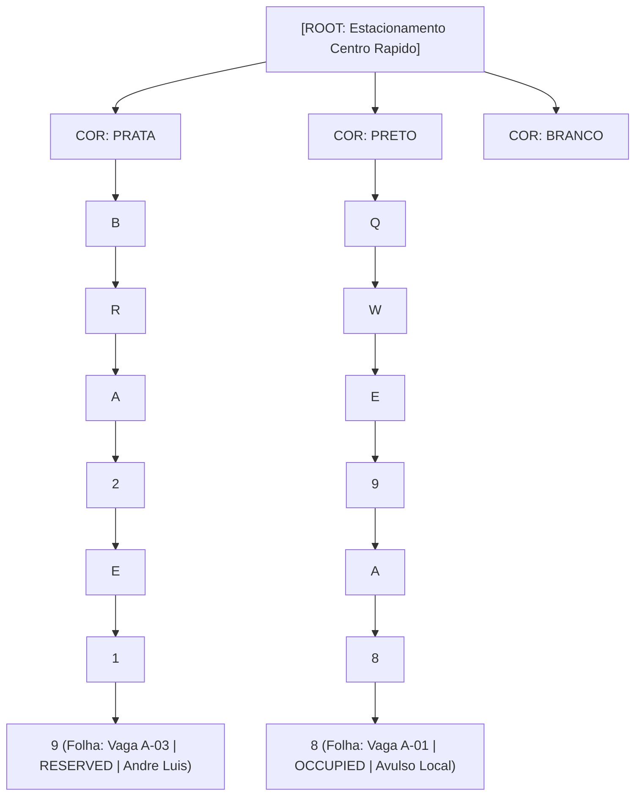

# Projeto VagaFlow ALPR — Plataforma B2B2C de Estacionamento Inteligente com Busca em Árvore (Trie) e Split Financeiro Automático


-2563EB?style=flat-square)


Plataforma integrada **B2B2C** de mobilidade urbana e gestão de estacionamentos inteligentes com reconhecimento óptico de placas (**ALPR — Automatic License Plate Recognition**), indexação em **Árvore de Prefixos (Trie)** particionada por cor do veículo e motor transacional de **Split de Pagamento** em **Java 21 + Spring Boot 3.3.4**.

---

## 1. Problema Urbano Resolvido e Proposta de Valor (B2B2C)

Nos centros urbanos, motoristas perdem tempo circulando em busca de vagas disponíveis enquanto estacionamentos comerciais sofrem com ociosidade não monitorada, filas em cancelas físicas de ticket impresso e desistências de reservas (*No-Show*) que bloqueiam vagas sem remuneração ao proprietário.

O **VagaFlow ALPR** soluciona esse cenário unificando três módulos em tempo real:
1. **App do Motorista (B2C):** Radar em tempo real de estacionamentos e comércios próximos, transparência de tarifas, vínculo óptico da placa Mercosul (Frontal ou Traseira) e reserva instantânea com trava garantida de **15 minutos (`TTL = 900s`)**.
2. **Motor de Cancela Óptica ALPR com Busca em Árvore (Edge + API Spring Boot):** Sincronização imediata via payload JSON (`POST /api/v1/reservations/sync-gate`) que indexa o veículo em uma **Árvore Trie de 7 níveis precedida pela Cor do Carro**, liberando a cancela em tempo constante $O(7)$ mesmo sob falhas de 1 caractere na leitura óptica da câmera (**Distância de Hamming $\le 1$**).
3. **Portal Web do Estacionamento (B2B):** Painel *Bento Grid* para monitoramento de vagas (`AVAILABLE`, `RESERVED`, `OCCUPIED`), entrada de veículos avulsos (sem app, abatendo do estoque em tempo real), cadastro de novos pátios e acompanhamento do *Live Gate Feed* e do faturamento líquido.

---

## 2. Arquitetura do Repositório (Monorepo)

```text
vagaflow-alpr/
├── README.md                          # Documentação completa (Arquitetura, Regras de Negócio, Árvore Trie, Como Rodar)
├── docs/
│   ├── architecture.md                # Fluxo B2B2C, Split de Pagamento e Diagrama de Sequência (Mermaid)
│   └── api-contracts.json             # Exemplos de payloads JSON trocados entre App, API e Câmera
├── backend/                           # API Java 21 + Spring Boot 3.3.4 (Maven)
│   ├── pom.xml
│   └── src/
│       ├── main/
│       │   ├── java/com/vagaflow/alpr/
│       │   │   ├── VagaFlowApplication.java
│       │   │   ├── config/                # CORS (WebCorsConfig) e Seed Inicial (DataInitializerConfig)
│       │   │   ├── controller/
│       │   │   │   ├── ParkingLotController.java      # Cadastro de pátios, vagas e listagem no radar
│       │   │   │   ├── ReservationController.java     # Reserva de 15 min, sync-gate e expiração No-Show
│       │   │   │   ├── GateCameraController.java      # Simulador de câmera ALPR (ENTRY, EXIT, Fuzzy OCR)
│       │   │   │   └── GlobalExceptionHandler.java    # Padronização de erros HTTP REST
│       │   │   ├── domain/
│       │   │   │   ├── entity/            # ParkingLot, Spot, Reservation, Vehicle, FinancialTransaction
│       │   │   │   └── enums/             # SpotStatus, PlateAngle, ReservationStatus, GateDirection
│       │   │   ├── dto/                   # Records Java para Request/Response e Payloads JSON da Cancela
│       │   │   ├── engine/
│       │   │   │   ├── PlateTrieNode.java             # Nó da Árvore de Prefixos
│       │   │   │   └── ParkingTreeIndexService.java   # Busca em Árvore (Cor -> 7 chars da Placa) + Hamming <= 1
│       │   │   ├── repository/            # Spring Data JPA Repositories (H2 in-memory / PostgreSQL)
│       │   │   ├── scheduler/
│       │   │   │   └── ReservationNoShowScheduler.java # Job que verifica reservas expiradas (>15 min) e aplica multa de 50%
│       │   │   └── service/
│       │   │       ├── ParkingLotService.java
│       │   │       ├── ReservationService.java
│       │   │       ├── BillingSplitService.java       # Cálculo do Markup fixo de R$ 1,00 e Split de No-Show
│       │   │       └── GateAccessService.java
│       │   └── resources/
│       │       └── application.yml
│       └── test/
│           └── java/com/vagaflow/alpr/
│               ├── ReservationAndGateIntegrationTest.java
│               ├── engine/ParkingTreeIndexServiceTest.java
│               └── service/BillingSplitServiceTest.java
└── frontend/                          # Interface Web ("Asphalt & Signal" Design System)
    ├── index.html                     # Workspace integrado conectado à API Spring Boot (ou modo fallback local)
    ├── css/
    │   └── asphalt-signal.css         # Estilos extraídos do protótipo (variáveis CSS, Bento Grid, Mercosul Badge)
    └── js/
        ├── api-client.js              # Fetch API conectando com http://localhost:8080/api/v1
        ├── tree-visualizer.js         # Renderização visual da Trie e do JSON trocado
        └── app.js                     # Lógica do App B2C, Modal de 15 min, Simulador de Câmera e Dashboard B2B
```

---

## 3. Regras de Negócio e Modelo Financeiro de Split

### 3.1 Taxa Fixa da Plataforma (`PLATFORM_FEE = R$ 1,00`)
- O proprietário do estacionamento cadastra seu valor base por hora (`ownerHourlyRate`, ex.: **R$ 7,00/h**).
- A plataforma soma automaticamente **R$ 1,00** de taxa operacional fixa (`totalHourlyPrice = ownerHourlyRate + 1.00`, exibindo **R$ 8,00/h** no App do Motorista).
- Em toda operação liquidada (seja checkout normal de estacionamento ou multa de *no-show*), **R$ 1,00** é destinado de forma invariante para a receita da plataforma e o valor remanescente é transferido ao dono do estacionamento.

### 3.2 Janela Pop-up Pré-Reserva (Aviso Obrigatório dos 15 Minutos)
- Antes de o cliente confirmar a reserva no App B2C, o sistema exibe obrigatoriamente o modal de confirmação com o aviso:
  > **"Se em 15minutos nao estiver na vaga é cobrado metade do valor minimo!"**
- O modal detalha a decomposição financeira transparente: para uma tarifa mínima de **R$ 8,00/h** (`R$ 7,00` pátio + `R$ 1,00` plataforma), a multa de 50% por não comparecimento em 15 minutos é de **R$ 4,00**, sendo **R$ 3,00** repassados ao dono do estacionamento e **R$ 1,00** fixo para a plataforma.

### 3.3 Expiração de 15 Minutos (*No-Show*) e Split Automático
- Quando o motorista confirma a reserva (`POST /api/v1/reservations/sync-gate`), a vaga muda imediatamente de `AVAILABLE` para `RESERVED` (`TTL = 900 segundos`) e o veículo é indexado na árvore da cancela.
- Caso o cronômetro de 15 minutos zere sem detecção de entrada (`ENTRY`) na câmera óptica, o evento `RESERVATION_EXPIRED_NO_SHOW_15MIN` é disparado:
  - A vaga retorna ao status `AVAILABLE` e o veículo é removido da Árvore Trie do pátio;
  - Executa-se a cobrança automática de 50% do valor mínimo de 1 hora:
    - `chargedFromCustomerBRL = totalHourlyRate / 2.0`
    - `transferredToPlatformBRL = 1.00`
    - `transferredToParkingOwnerBRL = chargedFromCustomerBRL - 1.00`

| Pátio Cadastrado | Valor Base Dono | Preço Exibido no App | Split Checkout 1h (Dono / App) | Multa No-Show 15m (50%) | Split No-Show (Dono / App) |
| :--- | :---: | :---: | :---: | :---: | :---: |
| **Estacionamento Centro Rápido (`LOT-01`)** | R$ 7,00/h | R$ 8,00/h | R$ 7,00 / R$ 1,00 | R$ 4,00 | R$ 3,00 / R$ 1,00 |
| **Farmácia & Comércio Central (`LOT-02`)** | R$ 5,00/h | R$ 6,00/h | R$ 5,00 / R$ 1,00 | R$ 3,00 | R$ 2,00 / R$ 1,00 |

---

## 4. Motor ALPR com Busca em Árvore (`Cor -> Trie de Prefixos da Placa`)

O serviço [`ParkingTreeIndexService.java`](./backend/src/main/java/com/vagaflow/alpr/engine/ParkingTreeIndexService.java) e a estrutura [`PlateTrieNode.java`](./backend/src/main/java/com/vagaflow/alpr/engine/PlateTrieNode.java) implementam uma árvore de busca em múltiplos níveis otimizada para leitura óptica de placas em cancelas:



### Três Camadas de Resolução na Cancela (`search(lotId, color, plate)`)
1. **`EXACT_TREE_MATCH (O(7))`:** Travessia exata pelos 7 caracteres da placa dentro da sub-árvore correspondente à cor detectada pela câmera. Complexidade determinística $O(L)$ onde $L = 7$, independente do número total de veículos no pátio.
2. **`FUZZY_COLOR_TREE_MATCH (Distância de Hamming <= 1)`:** Caso a câmera sofra reflexo solar, chuva ou sujeira na lente e erre 1 caractere no OCR (ex.: ler `BRA2E18` em vez de `BRA2E19`, ou confundir `0` com `O` e `8` com `B`), o algoritmo filtra os veículos daquela mesma cor na árvore e calcula a Distância de Hamming posicional, recuperando instantaneamente a placa real quando $\text{Hamming}(P_{\text{real}}, P_{\text{OCR}}) \le 1$.
3. **`EXACT_PLATE_CROSS_COLOR`:** Fallback que busca a sequência exata de 7 caracteres nas demais sub-árvores de cor caso a iluminação noturna ou sombras alterem a percepção cromática do sensor óptico.

---

## 5. Endpoints Principais da API REST (`http://localhost:8080/api/v1`)

| Método | Endpoint REST | Descrição |
| :---: | :--- | :--- |
| `GET` | `/api/v1/parking-lots` | Lista todos os pátios, tarifas calculadas (`+ R$ 1,00`), multa de no-show e status das vagas. |
| `POST` | `/api/v1/parking-lots` | Cadastra um novo estacionamento parceiro B2B e inicializa sua Árvore Trie. |
| `GET` | `/api/v1/parking-lots/metrics` | Retorna os acumuladores financeiros (`platformRevenueTotal`, `partnerRevenueTotal`, `totalOperations`). |
| `POST` | `/api/v1/reservations/sync-gate` | Aloca vaga como `RESERVED` por 15 min, indexa na Árvore da câmera e retorna o JSON de sincronização. |
| `POST` | `/api/v1/reservations/{id}/trigger-no-show` | Dispara a expiração de 15 minutos, libera a vaga e executa o split automático de 50%. |
| `POST` | `/api/v1/gate/events` | Processa leitura óptica da câmera ALPR na cancela (`ENTRY` ou `EXIT`) via busca na Árvore Trie. |
| `GET` | `/api/v1/gate/tree/{lotId}` | Retorna a representação hierárquica em tempo real da Árvore Trie do pátio selecionado. |
| `GET` | `/api/v1/gate/search` | Testa a resolução em 3 camadas (Exata, Fuzzy Hamming $\le 1$ e Cross-Color) para uma placa e cor. |

---

## 6. Como Executar o Projeto Localmente

### Pré-requisitos
- **Java 21 LTS** (JDK 21)
- **Apache Maven 3.9+**
- Navegador Web moderno (Chrome, Edge ou Firefox)

### Passo 1: Executar os Testes Automatizados (JUnit 5 + Mockito)
```powershell
cd backend
mvn clean test
```

### Passo 2: Iniciar a API Backend (Spring Boot 3)
```powershell
cd backend
mvn spring-boot:run
```
- A API estará disponível em `http://localhost:8080/api/v1/parking-lots`
- Documentação interativa Swagger UI: `http://localhost:8080/swagger-ui.html`
- Console do banco H2 em memória: `http://localhost:8080/h2-console` (`JDBC URL: jdbc:h2:mem:vagaflowdb`)

### Passo 3: Abrir a Interface Web ("Asphalt & Signal")
Abra o arquivo [`frontend/index.html`](./frontend/index.html) no navegador (ou sirva a pasta `frontend/` com qualquer servidor estático, como `npx serve frontend` ou `python -m http.server 3000 --directory frontend`).
- O badge no topo da interface detectará automaticamente a API (`API SPRING BOOT: ONLINE (:8080)`).
- Caso o backend não esteja em execução, o frontend opera de forma autônoma em **Modo Simulador Local (Fallback)** mantendo 100% das funcionalidades interativas.
