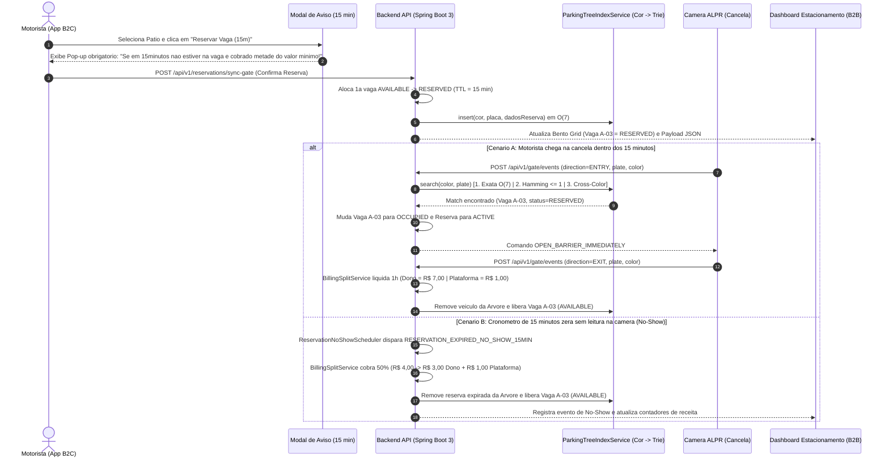

# Arquitetura do Sistema — VagaFlow ALPR (B2B2C Smart Parking)

## 1. Visao Geral do Modelo B2B2C e Split Financeiro

O **VagaFlow ALPR** opera como um ecossistema integrado **B2B2C** que conecta tres pontas em tempo real:
1. **Aplicativo do Motorista (B2C):** Permite localizar estacionamentos proximos em um radar urbano, visualizar precos transparentes, anexar foto de validacao da placa (Frontal ou Traseira) e reservar uma vaga instantaneamente com bloqueio garantido por 15 minutos (`TTL = 900s`).
2. **Motor de Cancela Optica ALPR + Busca em Arvore (Edge + Backend Spring Boot):** Indexa os veiculos reservados e estacionados em uma **Arvore de Prefixos (Trie)** particionada primariamente pela **Cor do Veiculo** e secundariamente pelos **7 caracteres da placa** (`O(7)`), com tolerancia a falhas de OCR por **Distancia de Hamming <= 1**.
3. **Portal Web do Estacionamento (B2B):** Painel operacional em tempo real (*Bento Grid*) para gestao de ocupacao das vagas (`AVAILABLE`, `RESERVED`, `OCCUPIED`), cadastro de novos patios, entrada de carros avulsos (sem aplicativo) e acompanhamento do *Live Gate Feed* e do faturamento liquido.

---

## 2. Regra de Precificacao e Split Financeiro (`PLATFORM_FEE = R$ 1,00`)

Em todas as transacoes liquidadas na plataforma, aplica-se uma regra invariante de *Take Rate* fixo:

$$\text{Preco Hora no App} = \text{Valor Base do Dono} + \text{R\$ } 1,00$$

| Cenario Operacional | Cobrado do Motorista | Receita da Plataforma (Fixa) | Repasse ao Dono do Patio | Exemplo (`Base Dono = R$ 7,00/h`) |
| :--- | :--- | :--- | :--- | :--- |
| **Checkout Normal (1a Hora)** | $\text{Valor Dono} + 1,00$ | $\text{R\$ } 1,00$ | $\text{Valor Dono}$ | Cobrado: **R$ 8,00** (`R$ 7,00` Dono + `R$ 1,00` App) |
| **Multa No-Show (Expiracao 15 min)** | $\frac{\text{Valor Dono} + 1,00}{2}$ | $\text{R\$ } 1,00$ | $\frac{\text{Valor Dono} + 1,00}{2} - 1,00$ | Cobrado: **R$ 4,00** (`R$ 3,00` Dono + `R$ 1,00` App) |

---

## 3. Diagrama de Sequencia do Fluxo de Reserva, Sincronizacao ALPR e Split

---

## 4. Arquitetura da Arvore de Busca ALPR (`ParkingTreeIndexService`)

Para garantir abertura instantanea da cancela sem varreduras sequenciais lentas e com resiliencia a falhas opticas de leitura (OCR), o indice em memoria opera em dois estagios hierarquicos por estacionamento:

1. **Particionamento de Raiz por Cor (`Map<String, PlateTrieNode> colorRoots`):**
   - Divide o espaco de busca pela cor do veiculo (`PRATA`, `PRETO`, `BRANCO`, `VERMELHO`, `AZUL`).
2. **Arvore de Prefixos de 7 Niveis (`PlateTrieNode`):**
   - Cada caractere alfanumerico da placa Mercosul ou antiga (`L = 7`, ex.: `B -> R -> A -> 2 -> E -> 1 -> 9`) corresponde a uma transicao de nivel na Trie.
3. **Estrategia de Resolucao em 3 Camadas (`search(lotId, color, plate)`):**
   - **Camada 1 — `EXACT_TREE_MATCH (O(7))`:** Travessia direta dos 7 caracteres na sub-arvore da cor detectada.
   - **Camada 2 — `FUZZY_COLOR_TREE_MATCH` (Distancia de Hamming $\le 1$):** Se a camera confundir um caractere por reflexo, chuva ou sujeira (ex.: ler `BRA2E18` em vez de `BRA2E19`), o servico percorre as folhas da mesma cor e recupera a placa cuja distancia posicional de Hamming seja $\le 1$.
   - **Camada 3 — `EXACT_PLATE_CROSS_COLOR`:** Caso a iluminacao noturna distorca a cor percebida pela camera, realiza a busca exata `O(7)` nas raizes das demais cores.
